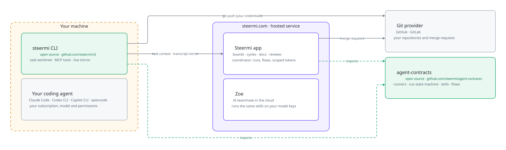

# steermi CLI

Work on [Steermi](https://steermi.com) tasks with your own coding agent on
your own machine and subscription. Steermi supplies the context (ticket, epic,
docs, project context, workflow instructions) and tools over MCP; your
session is mirrored so the team can follow it. Supported agents:
[Claude Code](https://claude.com/claude-code), Codex CLI, GitHub Copilot CLI
and opencode.

> Using the CLI needs a Steermi account.

<p align="center">
  <picture>
    <source media="(prefers-color-scheme: dark)" srcset="docs/images/ecosystem-dark.svg">
    
  </picture>
</p>

**Status:** pre-1.0. Commands and configuration paths are stable; flags may
still change between minor versions (see [CHANGELOG.md](CHANGELOG.md)).
Supported platforms: macOS and Linux (amd64, arm64).

## Install

With Go 1.27.4 or newer:

```bash
go install github.com/steermi/cli/cmd/steermi@latest
```

Or download an archive for your platform from the
[releases page](https://github.com/steermi/cli/releases), verify it, and put
`steermi` on your `PATH`:

```bash
sha256sum --check --ignore-missing checksums.txt        # macOS: shasum -a 256 -c
gh attestation verify steermi_*_$(uname -s)_$(uname -m).tar.gz --repo steermi/cli
tar -xzf steermi_*_$(uname -s)_$(uname -m).tar.gz steermi
install -m 0755 steermi ~/.local/bin/steermi
```

Requires `git` and Claude Code (`claude`, logged in). `steermi doctor` checks
both.

**Uninstall:** `steermi logout`, revoke the device in Steermi
(**Settings → Devices**), delete the binary, `~/.config/steermi` and, if you
used it, `~/.steermi/worktrees`.

## First run

```bash
steermi login                      # opens the browser to approve this device
steermi login --no-browser         # over SSH: paste the code shown in the browser
steermi repos link                 # inside a checkout: launches find it from anywhere
steermi doctor                     # checks claude, git, login and this checkout
```

The device appears under **Settings → Devices** in Steermi, where you can
revoke it. Self-hosted or local installations: `--url https://…` or
`STEERMI_URL`.

## Daily use

```bash
steermi                  # status: active launch, next work, installed agents
steermi next             # your current cycle: continue / up next / pick up
steermi next --all       # include items outside the cycle
steermi work STE-123     # start a specific task (--skill steermi:review; default steermi:build)
steermi run lx_7Q4XK2M9ab   # start a launch created in Steermi ("Work locally")
```

`run`, `work` and `next` create a worktree in
`~/.steermi/worktrees/<repo>/<KEY>` on the task branch (`--here` uses the
current checkout), write `.steermi/TASK.md` and `.steermi/SYSTEM.md`, show a
launch card (checkout, agent, model, why, access, mirroring) and start your
agent with the steermi MCP server. Enter starts, `m` changes the model, `p`
the profile, `q` leaves the checkout ready without starting. Re-running the
same launch resumes the agent's conversation (Claude Code, Codex, Copilot).

Flags: `--profile NAME`, `--agent claude|codex|copilot|opencode`,
`--model ID`, `--effort low|medium|high`, `--yes` (skip the card prompt),
`--no-agent` (only prepare the checkout), `--background` (headless; Claude
Code uses `acceptEdits`, Codex `--sandbox workspace-write`, Copilot
`--allow-tool write`, each plus `allowed_tools` from `.steermi/runner.yaml`).
Skills that hand back an answer or findings (such as the built-in Plan and
Review) always run read-only; only code skills may edit.

Inside Claude Code: `/steermi:next`, `/steermi:work KEY`, `/steermi:done`,
`/steermi:handoff`, plus the `steermi_*` MCP tools and skills
(`steermi-implement`, `steermi-review`, `steermi-followups`). Other agents get
the same steps as instructions in the first prompt and use the MCP tools.

## Agents, profiles and model suggestions

A profile is an agent plus a model per tier:

```bash
steermi profile add                       # asks: agent, name, fast/standard/deep models
steermi profile add cx --agent codex --standard gpt-… --deep gpt-…
steermi profile use cx --runner findings  # review-type skills run with Codex
steermi profile list
steermi profile follow ask|auto|never     # how to treat Steermi's suggestion
```

For every run Steermi suggests a tier and an effort, never a model: a skill
can declare `metadata.steermi-effort: low|medium|high`, a second loop round
or a run after a failure escalates. The profile turns the tier into a model
(the nearest configured tier when one is missing); `--model` always wins.
`ask` (default) shows the suggestion on the launch card, `auto` applies it
without asking, `never` runs the profile's default model.

Without profiles the first installed agent runs with its own default model.
A repository may name a preferred profile in `.steermi/runner.yaml`
(`profile: cx`); developers without that profile keep their own default.

| Agent | MCP + instructions | Live mirror | Resume |
|---|---|---|---|
| Claude Code | embedded plugin (`--plugin-dir`), hooks, slash commands | yes (hooks) | yes |
| Codex CLI | `-c mcp_servers.steermi.*`, first prompt | yes (rollout file) | yes |
| Copilot CLI | `--additional-mcp-config`, first prompt | yes (session log) | yes |
| opencode | `OPENCODE_CONFIG` (per-run file), first prompt | summary only | no |

Adapters pass per-run flags, environment and files under `.steermi/agent/`;
they never edit an agent's global configuration. `steermi doctor` checks
every agent. When a run finishes, the CLI reports the agent, version, model
and effort it used; Steermi shows it as self-reported.

## Finishing

```bash
steermi done             # push the branch, open the MR, post the summary, close the launch
steermi done --commit    # commit leftovers first
steermi handoff          # push WIP and continue the session in Steermi (cloud)
```

The ticket moves to *In review* through the merge request webhook. Finishing
a launch is not acceptance: a teammate still reviews and accepts the work in
Steermi.

## How it works

<p align="center">
  <picture>
    <source media="(prefers-color-scheme: dark)" srcset="docs/images/ecosystem-detailed-dark.svg">
    
  </picture>
</p>

- **Your machine:** the CLI starts your own coding agent on your own
  subscription in a task worktree, with Steermi's MCP tools; your session is
  mirrored live so the team can follow it.
- **In the browser:** your team plans on boards and cycles, picks skills and
  flows, works with Zoe in live sessions and reviews what she proposes.
  Nothing Zoe proposes is applied until a person accepts it.
- **Zoe in the cloud:** runs skills, chats, `@Zoe` mentions and scheduled
  routines on your organization's own model keys (BYOK), added by owners and
  admins and stored encrypted.

## What leaves your machine

- The task context is downloaded with a launch token scoped to that one task.
- Your agent's transcript (messages, tool calls, todos) is mirrored to the
  task's Steermi session so your team can follow it. Known credential formats
  (API keys, tokens, private keys, passwords in URLs) are replaced with
  `[REDACTED]` before upload; treat this as a safety net and keep secrets out
  of agent sessions.
- `git push` uses your own Git credentials. Steermi never receives them.
- Model usage runs on your own agent subscription or keys.
- When a launch finishes: the agent name, its version, the model and effort
  (self-reported, shown in Steermi as such).

## Configuration

`.steermi/runner.yaml` in a repository (shared with the team):

```yaml
profile: codex            # optional: preferred profile for this repository
allowed_tools:            # Claude Code syntax; Copilot maps Bash(x) to shell(x)
  - "Bash(make test)"
  - "Bash(go test *)"
```

| Path | Contents |
|---|---|
| `~/.config/steermi/credentials.json` (0600) | device refresh token, cached access token |
| `~/.config/steermi/repos.json` | remote → checkout links |
| `~/.config/steermi/profiles.json` (0600) | agent profiles, follow mode |
| `~/.config/steermi/launches/<id>.json` (0600) | launch token, mirror offset |
| `~/.config/steermi/plugin/steermi` | the embedded Claude Code plugin |
| `<checkout>/.steermi/` (git-excluded) | `TASK.md`, `SYSTEM.md`, `launch.json` (ids only), `agent/` (per-run agent config, no tokens) |

`STEERMI_CONFIG_DIR` moves the configuration directory; `NO_COLOR` turns
colour off (output is plain when piped). `steermi setup`
registers `steermi://launch/<id>` links (macOS, Linux);
`STEERMI_TERMINAL=iTerm` opens iTerm instead of Terminal on macOS.

## Marketplace install (optional)

The plugin is also a Claude Code marketplace:

```text
/plugin marketplace add steermi/cli
/plugin install steermi@steermi
```

When it is installed, `steermi run` does not load its embedded copy a second
time. The marketplace copy calls `steermi` from your `PATH`.

## Documentation

- [docs/architecture.md](docs/architecture.md): how launches, the plugin, MCP
  tools and the mirror fit together, and what runs in the hosted service.
- [docs/development.md](docs/development.md): build, test and try the CLI
  against a local fixture gateway, no account needed.
- [docs/troubleshooting.md](docs/troubleshooting.md): common errors.
- [docs/releasing.md](docs/releasing.md): maintainers' release checklist.

## Contributing

See [CONTRIBUTING.md](CONTRIBUTING.md); `make check` runs what CI runs.
Security reports: [SECURITY.md](SECURITY.md). Questions: Discussions.

## License

[Apache-2.0](LICENSE). Third-party notices:
[THIRD_PARTY_NOTICES.md](THIRD_PARTY_NOTICES.md).
